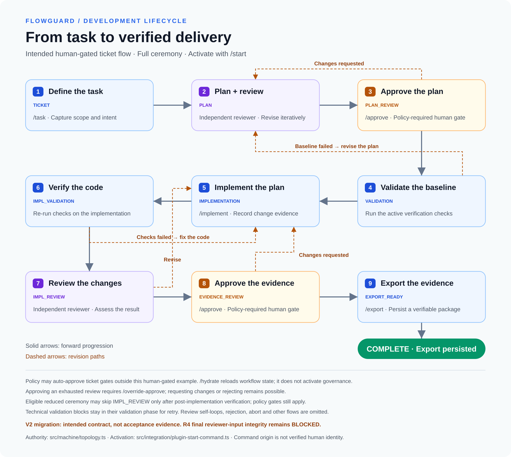

# FlowGuard

Host-aware governance runtime for AI-assisted software delivery.

**Technical Preview** · **TypeScript** · **Proprietary**

AI coding agents can generate code. That alone does not show what was reviewed,
which checks passed, or who approved the change. FlowGuard makes those steps
explicit through deterministic workflows, policy-bound decisions, and evidence
gates in supported host environments.

## Green checks are not enough

In a Java reference demonstration with a controlled positive and negative run,
build and tests passed in both cases.
In the positive run, the required adversarial assertion passed, the critical
claim was `PROVEN`, and FlowGuard completed the workflow with a verified export.
In the negative run, the adversarial assertion was skipped, the claim stayed
`NOT_VERIFIED`, and FlowGuard refused approval. No export was produced.

[Explore the reference evidence](docs/case-studies/java-governed-delivery.md) ·
This experiment used `develop@ede07f02`. The published Technical Preview is a
separate, version-bound artifact. The Java reference evidence remains bound to
its recorded product commit and `2.0.0-tp.2`; it is not live acceptance evidence
for `v2.0.0-tp.3`.

## Explore the Java demo

See how FlowGuard governs AI-assisted software delivery in a Java Spring Boot
application, from architectural decisions through implementation and independent
peer review.

- Independent AI reviews
- Policy-bound human approvals
- Automated baseline and implementation validation
- Verifiable evidence and tamper-evident audit trails

[Demo overview](demos/java-task-manager/README.md) ·
[Demo walkthrough](demos/java-task-manager/DEMO_SCRIPT.md) ·
[Evidence verification](demos/java-task-manager/EVIDENCE_PACKAGE.md) ·
[Reference evidence](docs/case-studies/java-governed-delivery.md)

This is a reading path through the demo documentation, not an executable quick
start.

## Request a hands-on evaluation

FlowGuard is proprietary software. The public repository is available for
read-only evaluation. Hands-on use requires prior written permission from the
copyright holder.

[Contact the author via LinkedIn](https://www.linkedin.com/in/benjamin-fuchs-ba6986190/)
to request an authorized technical evaluation or discuss your organization's
governance requirements.

## Core Capabilities

Each capability states the problem it addresses, the mechanism FlowGuard uses,
and where the technical contract is documented.

### Deterministic Governance

**Problem:** Agentic delivery is probabilistic. Prompt instructions alone cannot
guarantee gate order, prevent skipped approvals, or keep a policy stable for the
duration of a session.

**Mechanism:** Explicit phases and transitions, canonical state, fail-closed
gates, and an immutable policy snapshot bound at session creation. Four policy modes
cover different governance needs; a running session cannot switch policy arbitrarily.

| Mode          | Default behavior                                          |
| ------------- | --------------------------------------------------------- |
| **Solo**      | Policy-authorized automatic approvals                     |
| **Team**      | Human-gated, **default**                                  |
| **Team-CI**   | CI automation with local degradation controls             |
| **Regulated** | Mandatory independent review and actor-assurance controls |

**Reference:** [Phases](./docs/phases.md), [Policies](./docs/policies.md), and
[Architecture Principles](#architecture-principles).

### Independent Review

**Problem:** Self-review by the same agent or session is not independent
evidence, even when the text sounds convincing.

**Mechanism:** FlowGuard requires an independent `flowguard-reviewer` review for
`/plan`, `/architecture`, and `/implement`. Reviewer sessions are separated,
findings are bound to a review obligation, and enforcement fails closed at four
layers: reviewer invoked, session ID match, prompt context, and findings
integrity. Human approval remains a separate, policy-bound control. Structured
Plan Review Cards, Architecture Review Cards, and Review Report Cards are derived
presentation artifacts; `session-state.json` remains the SSOT. Content-Aware /review
accepts text, PR number, branch name, or URL input with subagent-attested content
analysis.

**Reference:** [Independent Review](./docs/independent-review.md) and
[Security Assurance](./docs/security-assurance.md).

### Evidence & ProofGraph

**Problem:** A passing test or a confident summary does not show which claim it
supports, whether the evidence is fresh, or whether a required proof is missing.

**Mechanism:** ProofGraph keeps claims, evidence, verification, independent
review, and approval distinct.

| Layer                  | Question it answers                             |
| ---------------------- | ----------------------------------------------- |
| **Claim**              | What exactly is asserted about the change?      |
| **Evidence**           | Which revision-bound artifact demonstrates it?  |
| **Verification**       | Does the required evidence establish the claim? |
| **Independent Review** | Does a separate reviewer accept the reasoning?  |
| **Approval**           | Who may approve under the frozen policy?        |

Critical plan-certified `fact` claims cannot reach evidence approval while
required revision-bound positive and adversarial evidence is missing. `PROVEN`
means the policy-required evidence succeeded; it does not mean the change is
free of defects. Residual uncertainty remains visible as `UNPROVEN`,
`CONTRADICTED`, `STALE`, `BLOCKED`, or `NOT_VERIFIED`.

**Reference:** [ProofGraph](./docs/proofgraph.md) and
[Security Assurance](./docs/security-assurance.md).

### Verifiable Auditability

**Problem:** Mutable logs and detached summaries cannot show which policy
governed a session, what was decided, or whether records changed afterwards.

**Mechanism:** Hash-chained, append-only audit events, decision receipts,
policy provenance, content-digested evidence artifacts, and offline-verifiable
evidence packages. Tamper detection operates within the documented trust model;
integrity verification is distinct from cryptographic identity attestation.
Actor assurance is policy-bound.

**Reference:** [Archive](./docs/archive.md),
[Enterprise Readiness](./docs/enterprise-readiness.md), and
[ProofGraph](./docs/proofgraph.md).

### Supported engineering environments

Profiles auto-detect TypeScript, Java, and Angular projects, and recognize
root-level Python, Rust, and Go ecosystem signals plus database engines
(PostgreSQL, MySQL, MariaDB, MongoDB, Redis, H2, SQLite, Oracle, SQL Server).
Bounded code-surface analysis detects endpoints, authentication, data, and
integration touchpoints. Archive exports are redacted by default, and derived
evidence artifacts preserve `sourceStateHash` provenance. See
[Profiles](./docs/profiles.md) and [Archive](./docs/archive.md).

## How FlowGuard Works

The diagram shows the standard full-ceremony, human-gated ticket lifecycle,
including baseline validation before implementation, fresh verification after
it, independent review loops, revision and error paths, and persisted export
evidence. It is not completed V2 acceptance. Installed Desktop acceptance is
tracked separately. Three governed flows are available after `/start`;
policy-authorized autonomy and reduced ceremony are separate paths.



### Ticket flow

1. `/start` — start governance and bootstrap the session
2. `/task "description"` — capture your governed task
3. `/plan` — generate an implementation plan (subagent-reviewed iteratively)
4. `/approve` — approve the plan (or `/request-changes` to revise)
5. `/implement` — execute the approved plan; FlowGuard runs the baseline validation automatically, then the post-implementation validation and the iterative subagent review
6. `/approve` — approve the implementation evidence (advances to EXPORT_READY)
7. `/export` — materialize the required verifiable export; the workflow reaches COMPLETE only after export evidence is persisted

### Architecture flow

1. `/start`
2. `/architecture title="..." adrText="..."` — record the ADR (MADR format,
   subagent-reviewed iteratively for Context completeness, Decision concreteness,
   Consequences honesty, MADR structure)
3. `/approve` — accept the ADR

### Peer / Content review flow

1. `/start`
2. `/review` — plain peer review report (no external content)
   OR `/review prNumber=42` / `branch=feature` / `url=https://...` /
   `text="diff"` → blocked with `requiredReviewAttestation` (obligation UUID)
3. With active plugin orchestration and verified native review transport,
   FlowGuard authorizes an independent reviewer and binds its structured findings
   to the review obligation. Free-form reviewer text is never accepted as a
   verdict. See [Independent Review](./docs/independent-review.md) for
   host-specific guarantees and acceptance status.
4. `/review prNumber=42 reviewFindings=<complete object>` →
   PEER_REVIEW_COMPLETE, receives structured `reviewCard`

### Command surface

**Diagnostic commands:** `/help` — context-sensitive next action and relevant commands.
`/commands` — currently available commands (`--all` for the complete reference).
`/status` — current phase, next action, evidence summary. `/why` — explain and resolve blockers.

**Advanced/canonical commands** (`/hydrate`, `/ticket`, `/review-decision`,
`/validate`, `/architecture`, `/review`, `/export`, `/archive`, `/abort`,
`/continue`, `/reconcile-mutation-episode`,
`/resolve-implementation-challenge`) remain fully supported for scripts, CI,
and power users.

**Native operator/diagnostic commands:** `/check`, `/debug-export`,
`/diagnostics`, `/recover-capacity`, `/end-governance`.

**Companion commands:** the optional TUI companion adds `/choose-workflow`. The
optional Desktop GUI adds `/choose-workflow`, `/flowguard-ui-probe` and
`/flowguard-inline`. Desktop-only commands are never reported as available on
TUI, headless or MCP hosts; without trusted Desktop capability evidence they
remain `not_verified`. See [Desktop GUI Companion](./docs/desktop.md) for the
read-only ComposerPill, optional API degradation and installed evidence scope.

See [docs/commands.md](./docs/commands.md) for the complete command reference and
[docs/independent-review.md](./docs/independent-review.md) for review obligations,
subagent attestation, and the `/review` evidence model.

## Current Release Status

> **Version:** 2.0.0-tp.3 | TypeScript | Host-aware | OpenCode synchronous enforcement path

| Status                           | Meaning                                                                                                                                                                                            |
| -------------------------------- | -------------------------------------------------------------------------------------------------------------------------------------------------------------------------------------------------- |
| **Released Technical Preview**   | [`2.0.0-tp.2`](https://github.com/koeppben23/governed-runtime/releases/tag/v2.0.0-tp.2), published 2026-10-04 as a GitHub Release artifact. Later `develop` changes are not part of that artifact. |
| **Current Development Snapshot** | The `develop` branch contains changes after the published artifact and is not a new release.                                                                                                       |
| **Installed Host Acceptance**    | Version- and host-bound capabilities only; tracked in #1196 and the host-probe records. Command availability alone is not acceptance.                                                              |
| **Production Readiness**         | Not complete. The published artifact is a technical preview, not a GA release.                                                                                                                     |

> **Release preparation:** `v2.0.0-tp.3` is being prepared from `develop` and
> has no published artifact until the protected tag workflow completes. The last
> published artifact remains `v2.0.0-tp.2` (2026-10-04).

> **OpenCode V2 status:** the V2-only port (#1169/#1190) and the native Desktop
> Workbench (#1207) are merged on `develop`. Remaining #1196 product and
> accessibility gates are tracked separately. Desktop commands and the
> read-only ComposerPill are documented in the command surface; the GUI artifact
> evidence remains bound to its installed bundle hash. Command availability
> alone is not installed-host acceptance, and this is not a GA release claim.

V2 must preserve V1 capabilities and governance guarantees, including
policy-permitted autonomous workflows and fully automatic independent AI review.
Explicit interactive and authorized autonomous activation are separate required
paths; human approvals remain policy-dependent. See
[ADR-010](./docs/decisions/010-host-neutral-opt-in-governance.md), amendment of 2026-11-02.

FlowGuard provides deterministic workflow control, evidence gates, audit trails,
and policy-bound decisions around supported AI-assisted engineering hosts.
OpenCode currently provides the strongest enforcement path through its
synchronous plugin; Claude Code and Codex are supported through MCP, hooks, and
native packaging with hook-gated, platform-limited guarantees. Claude Code and
Codex are technical previews.

### Enforcement boundaries

- Installed Desktop product and accessibility acceptance is tracked in #1196;
  command availability alone is not acceptance.
- OpenCode's public APIs do not currently guarantee the integrity of the final
  tool-result bytes consumed by the reviewer (R4, `NOT_SUPPORTED`). See
  [Platform Limitations](./docs/platform-limitations.md) for the trusted-plugin
  boundary and host-specific guarantees. Untrusted co-installed plugins are
  outside the supported boundary, and a native command alone does not prove
  human identity.
- `/start` activates governance; `/hydrate` does not.
- The standalone CLI wrappers (`flowguard run`, `flowguard serve`) are
  experimental. For production headless workflows, use OpenCode directly
  (`opencode run`, `opencode serve`).
- In headless or non-interactive execution, FlowGuard does not rely on follow-up
  questions: missing safety-critical inputs fail closed with explicit blocked
  reasons.
- FlowGuard is filesystem-first and offline-capable by default. Network-dependent
  surfaces are explicit: `/review url=...` HTTPS content loading, remote JWKS via
  `jwksUri`, and Claude Code HTTP hook mode's localhost listener.

## Installation & Licensing

### Installation

**Host requirement:** FlowGuard `2.0.0-tp.x` requires **OpenCode V2**. The native API baseline is 2.2.7; the independently verified CLI smoke pin is 2.2.5. OpenCode 1.x — including 1.3.3 — is the V1 host line and is **not supported**. Check with `opencode --version` and upgrade before installing. Other 2.2.x builds are not independently verified, and the plugin cannot load on V1.

FlowGuard is distributed as a pre-built proprietary release artifact via GitHub Releases.

1. **Download.** Fetch `flowguard-core-{version}.tgz` and `checksums.sha256` from the [Releases page](https://github.com/koeppben23/governed-runtime/releases) and keep both files in the same directory. Missing or mismatched checksum evidence blocks installation before any artifacts are written.
2. **Install.** Run:

   ```bash
   npx --package ./flowguard-core-{version}.tgz flowguard install \
     --core-tarball ./flowguard-core-{version}.tgz
   ```

   This writes the native plugin and managed files into the selected OpenCode directory. It does not activate governance.

3. **Verify.** Run:

   ```bash
   npx --package ./flowguard-core-{version}.tgz flowguard doctor
   ```

   `flowguard` is not a global command unless you installed the package globally; this guide does not require that. Always use the `npx --package ...` form, and add `--install-scope repo` if you installed with that scope. The command must exit 0 and report `Status: HEALTHY` or `Status: HEALTHY_WITH_WARNINGS`; `NOT_VERIFIED` or a non-zero exit means the installation is not verified.

4. **Reload the host.** OpenCode V2 watches plugin/config changes; run `/reload` to force rediscovery. Remaining installed Desktop/product and accessibility acceptance is tracked in #1196.

See [docs/installation.md](./docs/installation.md) for full instructions.

### Developer / Dogfood Install from Source

For a local checkout, use the release-equivalent package path in the canonical
[Dogfood Installation Guide](./docs/development/debugging.md).
It uses an isolated playground and `--install-scope repo`, rather than changing
the developer's global host configuration.

### Licensing

FlowGuard is proprietary software. The repository is public for evaluation, but
the [LICENSE](./LICENSE) grants viewing rights for evaluation only. It does not
grant a general right to use, copy, modify, or distribute the Work; prior
written permission from the copyright holder is required. Distribution and
support terms are documented in
[docs/distribution-model.md](./docs/distribution-model.md).

## Documentation & Architecture

### Documentation

| Document                                                             | Description                                                            |
| -------------------------------------------------------------------- | ---------------------------------------------------------------------- |
| [Installation](./docs/installation.md)                               | Install and configure FlowGuard                                        |
| [Quick Start](./docs/quick-start.md)                                 | First governed OpenCode session and command walkthrough                |
| [Commands](./docs/commands.md)                                       | Command reference                                                      |
| [Desktop GUI Companion](./docs/desktop.md)                           | Desktop commands, Workbench and read-only ComposerPill                 |
| [Phases](./docs/phases.md)                                           | Workflow phases and gates                                              |
| [Policies](./docs/policies.md)                                       | Solo, Team, Team-CI, Regulated modes                                   |
| [Independent Review](./docs/independent-review.md)                   | Review obligations, subagent attestation, and `/review` evidence model |
| [ProofGraph](./docs/proofgraph.md)                                   | Claims, evidence relations, and residual uncertainty                   |
| [Profiles](./docs/profiles.md)                                       | Tech stack profiles                                                    |
| [Archive](./docs/archive.md)                                         | Session archiving                                                      |
| [Enterprise Readiness](./docs/enterprise-readiness.md)               | Consolidated threat model and control boundaries                       |
| [Security Assurance](./docs/security-assurance.md)                   | Executable security gates, evidence, and explicit limits               |
| [Configuration](./docs/configuration.md)                             | Configuration reference                                                |
| [Troubleshooting](./docs/troubleshooting.md)                         | FAQ and error handling                                                 |
| [Architecture](./docs/architecture/architecture-diagram.md)          | Architecture layers, three governed flows, SSOT, proof surfaces        |
| [Development Guide](./docs/development/index.md)                     | Contributor navigation, setup, debugging, and architecture guidance    |
| [Developer Architecture Map](./docs/development/architecture-map.md) | Where a change belongs, owning modules, and enforced checks            |
| [Testing Strategy](./docs/testing-strategy.md)                       | Test tiers, CI jobs, performance budgets                               |
| [API Reference](https://koeppben23.github.io/governed-runtime/)      | TypeScript API reference (TypeDoc, GitHub Pages)                       |

### Product Documentation

| Document                                     | Audience         | Notes                                                                                                                                                                                              |
| -------------------------------------------- | ---------------- | -------------------------------------------------------------------------------------------------------------------------------------------------------------------------------------------------- |
| [PRODUCT_IDENTITY.md](./PRODUCT_IDENTITY.md) | Product overview | Architecture, capabilities, limitations                                                                                                                                                            |
| [AGENTS.md](./AGENTS.md)                     | Development repo | Local contributor notes for this repository. NOT the source of installed mandates — end users receive `flowguard-mandates.md`, which is rendered from `src/templates/mandates.ts` at install time. |

### Architecture Principles

1. **Fail-closed** — ambiguity blocks, never guesses
2. **Deterministic** — same state + input = same result
3. **Pure machine** — no side effects in transition logic
4. **Evidence-first** — every phase produces verifiable artifacts
5. **LLM-agnostic** — works with any model
6. **Zero-bridge** — same process, no subprocess shell-out
7. **Tamper-evident audit** — hash-chained, append-only, within the documented trust boundary
8. **Policy-bound** — every decision traced to a policy version

### Canonical Import Paths

| Entry Point                         | Purpose                                                                |
| ----------------------------------- | ---------------------------------------------------------------------- |
| `@flowguard/core`                   | Core schemas, machine/policy APIs, audit/archive verification, logging |
| `@flowguard/core/integration`       | Host integration surfaces, including OpenCode tool/plugin bindings     |
| `@flowguard/core/integration/tools` | Individual tool definitions                                            |
| `@flowguard/core/testing`           | Test utilities (`createTestContext`)                                   |

> Some exports, such as `SessionState`, are runtime Zod schemas.
> Use `z.infer<typeof SessionState>` for the corresponding TypeScript type
> unless a separate exported type exists.

### Policy Resolution APIs

| Use Case                                | API                                                 |
| --------------------------------------- | --------------------------------------------------- |
| Static preset lookup                    | `getPolicyPreset(mode)`                             |
| Runtime-aware with CI degradation       | `resolvePolicyWithContext(mode, ciContext?).policy` |
| Snapshot-based authoritative resolution | `resolvePolicyFromSnapshot(snapshot)`               |
| Hydrate lifecycle (full pipeline)       | `resolvePolicyForHydrate(opts)`                     |

## Development & Engineering Assurance

New to the codebase? Start with the
[Development Guide](./docs/development/index.md). It routes to the
[Developer Architecture Map](./docs/development/architecture-map.md), which maps
change types to owning modules and checks, and to
[Your First Change](./docs/development/first-change.md), an additive walkthrough.
Setup, debugging, and command selection are owned there and by
[docs/testing-strategy.md](./docs/testing-strategy.md); `package.json` is the
executable script authority.

### CI Jobs

The required `ci-gate` check aggregates the merge-blocking jobs: `unit` (unit,
scripts, and assertion-conformance tests), `scripts-windows`, `critical-windows`,
`coverage`, `integration-perf`, `provider-conformance`, `regulated-e2e`, and
`doc-drift`. Branch protection additionally requires `typecheck`, `lint`,
`format`, `architecture`, `build`, `build-clean`, `actionlint`, `secrets-scan`,
`security-policy`, `independent-review-e2e`, the cross-platform `install-verify`
jobs, `Validate Commit Messages`
(`.github/workflows/conventional-commits.yml`), and `audit` and `codeql-sast`
(`.github/workflows/security.yml`). What each security gate proves, and what it
does not, is documented in
[Security Assurance](./docs/security-assurance.md).

The test-focused job-to-script table lives in
[Testing Strategy](./docs/testing-strategy.md); the PR-CI workflow definition is
[`.github/workflows/ci.yml`](./.github/workflows/ci.yml), and the full
required-check contract is
[`.github/BRANCH-PROTECTION.md`](./.github/BRANCH-PROTECTION.md).

### Releases

`main` is the canonical release authority and is protected. Releases are
PR-first: a `v*` tag must point at a commit already contained in `origin/main`.
The full release process, artifact contents, integrity verification, and support
lifecycle are owned by [docs/release-policy.md](./docs/release-policy.md); see
[CONTRIBUTING.md](./CONTRIBUTING.md) for release branch conventions.

See [CONTRIBUTING.md](./CONTRIBUTING.md) for authorized-contributor guidelines.
