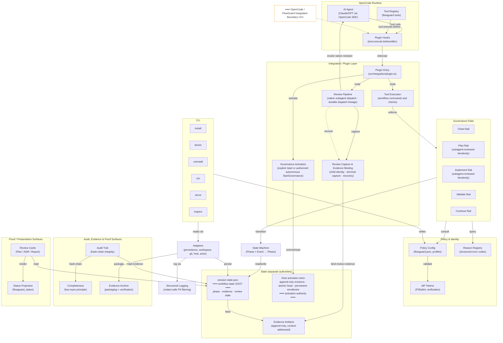

# FlowGuard Architecture

## Conceptual Architecture

**Runtime flow and module direction.** Arrows show runtime flow; where the
arrow connects two governed modules it follows the allowed dependency
direction. The single authority for module directions is
[`MODULE_DEPENDENCY_POLICY`](../../src/architecture/support/module-dependency-policy.ts)
(observed edges must equal the declared policy exactly); this diagram neither
defines nor widens it.



Activation is committed through the host-storage journal before workflow READY;
it selects the governed session scope but never writes workflow phase, evidence
or review state. The review pipeline's durable dispatch, child capture and
evidence binding are likewise separate from activation authority.

## Three Governed Flows

From `READY`, three flows are available:

### 1. Ticket Flow (Full Development Lifecycle)

```
READY → TICKET → PLAN ⇄ PLAN_REVIEW → VALIDATION → IMPLEMENTATION → IMPL_VALIDATION (automatic post-implementation checks; failure returns to IMPLEMENTATION) ⇄ IMPL_REVIEW → EVIDENCE_REVIEW → EXPORT_READY → COMPLETE
```

- `/task` → `/plan` → `/approve` → `/implement` (automatically runs active checks) → `/approve` → `/export`
- `/check` is a manual compatibility and recovery command, not part of the happy path.
- Subagent review loops at PLAN and IMPLEMENTATION for iterative convergence
- Approval gates at PLAN_REVIEW and EVIDENCE_REVIEW. The frozen policy selects
  the admissible authority: an explicit operator decision where required, or an
  authorized `autonomous` decision in policy modes that permit it. The command
  channel does not prove human provenance.
- Self-review never accepted as evidence — mandatory independent subagent attestation

### 2. Architecture Flow (ADR)

```
READY → ARCHITECTURE ⇄ ARCH_REVIEW → ARCH_COMPLETE
```

- `/architecture` → `/approve`
- MADR-format ADR with independent subagent review
- Fail-closed: `unable_to_review` verdict blocks at all layers

### 3. Peer Review Flow

```
READY → PEER_REVIEW → PEER_REVIEW_COMPLETE
```

- `/review` — content-aware (PR, branch, text, URL)
- Obligation-bound: each `/review` creates a `ReviewObligation`

## Key Design Principles

- **Fail-closed:** Default deny. Every decision must be explicitly approved.
- **Workflow-state SSOT:** `session-state.json` is the single source of truth for
  workflow phase, evidence and review state; no derived projection acts as
  authority. Activation is a separate authority: the host-storage journal,
  atomic head and permanent enrollment, never inferred from workflow files.
- **Review lineage:** native reviewer dispatch is bound to durable dispatch,
  child identity, terminal capture and evidence binding; a failed or incomplete
  capture cannot become review evidence.
- **Hash-chain audit:** Every state transition is cryptographically linked; tampering is detectable.
- **Immutable artifacts:** Evidence is persisted as content-addressed files in `artifacts/`.
- **Presentation ≠ Authority:** Review cards and status output are derived views — never read back as runtime state.
